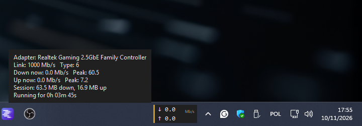

# Network Indicator

A two-line live throughput readout that lives on the Windows taskbar, next to the clock:
download rate on the first line, upload rate on the second, both in Mb/s. A thin bar on the
left carries the link status.


| Bar colour | Meaning |
|---|---|
| green | link up, traffic flowing |
| amber | link up, no measurable traffic in the last sample |
| red | no usable uplink (cable or Wi-Fi down, no adapter operational) |

Hover it for the details panel: adapter name, negotiated link speed and media type, current
and peak rates, session totals, uptime.



Right-click for the menu: reset counters, reposition, exit.

## Why it exists

Windows shows a network icon but not how fast anything is actually moving, and the usual
answer is either a browser tab with a speed test or a vendor utility that phones home. This is
a single file with no dependencies that reads the counters Windows already keeps.

## Install

```powershell
git clone https://github.com/ErynVornTechnologies/network-indicator.git
cd network-indicator
powershell -ExecutionPolicy Bypass -File .\install.ps1
```

`install.ps1` drops a shortcut named `Network Indicator.lnk` into the per-user Startup folder
(target `pythonw.exe`, so no console window ever appears) and starts the widget immediately.
Re-running it replaces the shortcut. Requires Python 3 with `tkinter`, which the python.org
build ships.

Uninstall:

```powershell
powershell -ExecutionPolicy Bypass -File .\uninstall.ps1
```

That removes the shortcut and stops this app's own `pythonw.exe` process only.

## How the numbers are read

`GetIfTable` from `iphlpapi.dll`, sampled once per second. The counters are 32-bit and wrap,
so each delta is computed as `(new - old) & 0xFFFFFFFF`; that stays correct as long as less
than 4 GB crosses the interface inside one sample, far outside any home connection.

Exactly one interface is reported: the fastest operational physical adapter. Excluded are
loopback, tunnels, WireGuard, Hyper-V/vEthernet, VirtualBox host-only, Wi-Fi Direct and the
NDIS filter layers (WFP, QoS, Lightweight Filter). Those filter layers are the trap: they
mirror the counters of the adapter underneath them, so counting every operational row
multiplies the same bytes several times. On the development machine 53 interface rows reduced
to exactly one legitimate candidate.

The rates were cross-checked against `Get-NetAdapterStatistics` over the same window (module
1.42 Mb/s, PowerShell 1.03 Mb/s, back-to-back samples) and against a real transfer, where the
peak read 60.5 Mb/s while a test download ran.

No third-party packages: `ctypes` and `tkinter` from the standard library only.

## Details that matter in daily use

- Placement is computed from the taskbar rectangles (`Shell_TrayWnd`, `TrayNotifyWnd`) and
  re-checked every 5 seconds, so a taskbar restart or a resolution change does not leave the
  widget stranded. It sits just left of the notification area, the only spot that does not
  cover the tray icons.
- With an auto-hidden taskbar the widget withdraws instead of floating over the desktop.
- One instance only, enforced by a named mutex, so launching it twice is harmless.
- A 1-second sampling window shows bursts as bursts. The peak in the details panel is the
  number to compare against the line's advertised speed.
- Media type comes from the interface type: Ethernet, Wi-Fi, PPP.

## Files

| File | Purpose |
|---|---|
| `network_indicator.py` | the widget |
| `install.ps1` | startup shortcut plus launch |
| `uninstall.ps1` | removes the shortcut and stops the widget |
| `docs/` | screenshots used above |

## License

MIT, see [LICENSE](LICENSE). Author: Kamil Nagorski, ErynVorn Technologies.
